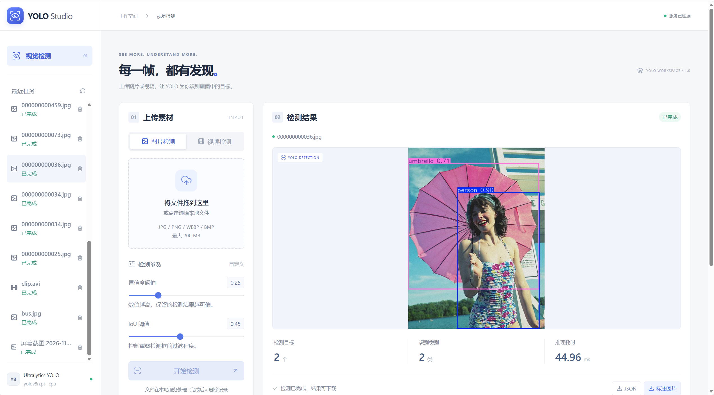
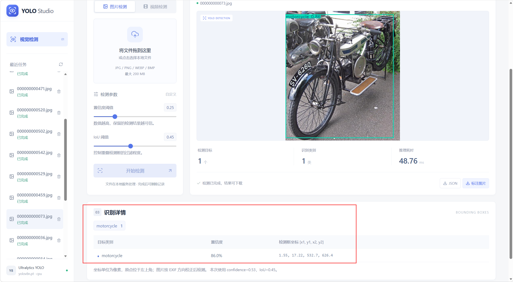
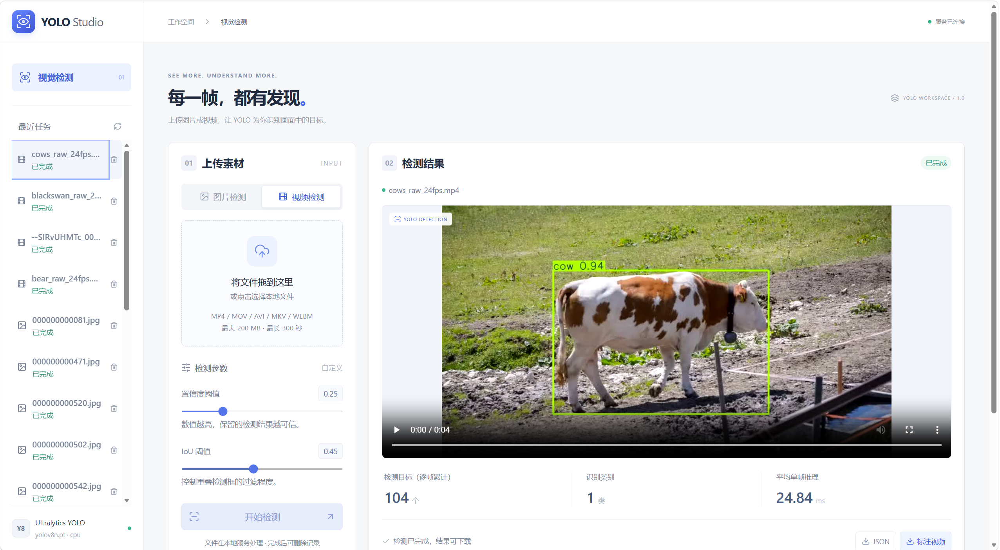

# YOLO Studio

**一个下载后可在本机启动的 YOLO 图片与视频目标检测网站。**

Vue 3 + FastAPI + Ultralytics YOLOv8n，提供中文界面、检测框可视化、视频逐帧处理，以及标注文件与 JSON 下载。

[快速开始](#快速开始windows) · [功能与效果](#功能与效果) · [开发说明](#开发与自定义) · [常见问题](#常见问题) · [许可](#许可与来源)

## 功能与效果

- **图片检测**：上传 JPG、PNG、WEBP、BMP，显示目标类别、置信度与检测框。
- **视频检测**：上传 MP4、MOV、AVI、MKV、WEBM，每帧检测，显示后台处理进度。
- **参数调节**：可设置置信度阈值和 IoU 阈值。
- **结果下载**：带框图片、浏览器可播放的 H.264 视频、完整检测 JSON。
- **任务记录**：查看历史结果、统计类别、删除已完成的任务。
- **本地运行**：上传文件在本地服务处理；预构建前端已包含，普通用户无需安装 Node.js。

### 图片检测



### 类别、置信度与坐标



### 视频逐帧检测



> `test-pics/` 中的三张 PNG 是界面效果截图，用于展示功能，不是训练数据集或原始测试素材。截图为示例结果，具体识别结果会随素材、模型和阈值变化。

## 快速开始（Windows）

### 1. 安装 Python

推荐使用 **Python 3.11 或 3.12（64 位）**，从 [Python 官网](https://www.python.org/downloads/windows/) 安装，安装时勾选 **Add Python to PATH**。

打开命令提示符，输入以下命令确认安装成功：

```bat
python --version
```

无需安装 Node.js，也不需要 GPU。CPU 可以运行，建议至少 8 GB 内存并预留数 GB 磁盘空间供依赖和视频临时文件使用。

### 2. 下载项目

在本仓库页面选择 **Code → Download ZIP**，下载后先完整解压，再进入 `yolo-studio-main` 文件夹。

也可以使用 Git：

```bash
git clone https://github.com/Frankie32244/yolo-studio.git
cd yolo-studio
```

### 3. 双击启动

双击项目根目录的 **`start.cmd`**。

启动脚本会自动：

1. 在项目内创建独立的 `.venv` Python 环境。
2. 首次运行时安装后端依赖，后续启动复用已安装环境。
3. 启动网站，并在服务就绪后打开默认浏览器。

**第一次启动需要联网，安装 PyTorch 等依赖可能需要数分钟。** 仓库已包含约 6.3 MiB 的 `yolov8n.pt` 权重和 `frontend/dist` 页面，不需要手动下载默认模型或构建前端。

默认地址为 **http://127.0.0.1:8000**。若端口被占用，脚本自动选择 8001–8020；以启动窗口显示的地址为准。

保持启动窗口打开，按 **Ctrl+C** 停止网站。不要在 ZIP 压缩包里直接运行，也不要只单独复制 `start.cmd`。

### 4. 开始检测

选择“图片检测”或“视频检测” → 上传素材 → 调节参数 → 点击“开始检测” → 等待完成 → 下载标注结果或 JSON。

默认最大上传 **200 MiB**，视频最长 **300 秒**。首次检测需要加载模型；CPU 处理视频可能慢于实时，建议先用 5–10 秒短片测试。

## Linux / macOS

无需安装 Node.js，直接使用已构建前端：

```bash
git clone https://github.com/Frankie32244/yolo-studio.git
cd yolo-studio
python3 launch.py
```

`launch.py` 同样自动创建环境、安装依赖并启动网站。无桌面环境可使用终端显示的地址访问，不依赖自动打开浏览器。

如 Debian/Ubuntu 提示缺少 `libGL.so.1`，安装系统库：

```bash
sudo apt-get update
sudo apt-get install libgl1 libglib2.0-0
```

Windows 本地运行已验证；Linux/macOS 启动路径和 Docker 配置提供给对应环境使用，尚未在这些系统中实测。

## Docker

```bash
docker compose up --build
```

访问 http://127.0.0.1:8000 。任务结果保存在命名卷中。按 Ctrl+C 或运行 `docker compose down` 停止。Docker 首次构建需要联网，本项目尚未在 Docker 引擎中实测。

## 结果说明

| 字段 | 含义 |
| --- | --- |
| `label` | 类别名称，例如 `person`、`car`、`cow` |
| `confidence` | 检测置信度，范围 0–1 |
| `bbox` | 像素坐标 `[x1, y1, x2, y2]`，原点位于左上角 |
| `inference_time_ms` | 推理处理耗时，不含首次下载和模型加载 |
| `frame_index` | 视频帧编号，从 0 开始 |
| `timestamp_seconds` | 按源平均帧率计算的帧时间 |

- 默认模型识别 COCO 的 **80 类**目标，不能识别任意自定义类别。
- 视频目标数是**各帧检测框累计数**，不代表独立对象数量；本项目没有目标追踪或跨帧去重。
- 视频输出为带框 H.264 MP4，**不保留音轨**；变帧率素材输出为按源平均 FPS 编码的恒定帧率视频。
- 图片会按 EXIF 方向校正，坐标对应校正后的图片。

## 开发与自定义

日常使用不需要重新构建前端。修改 Vue 页面时，需要 Node.js 22.12+：

```bash
cd frontend
npm install
npm run build
```

构建后重启后端。也可使用仓库内锁定的 pnpm 依赖：`pnpm install --frozen-lockfile`、`pnpm build`。

独立启动 API：

```bash
# Windows，完成 start.cmd 首次安装后
.venv\Scripts\python.exe -m uvicorn app.main:app --app-dir backend --host 127.0.0.1 --port 8000 --workers 1
```

Vite 开发服务运行 `npm run dev`，地址为 http://127.0.0.1:5173 ，会将 `/api` 转发到本机 8000 端口。API 文档：`http://127.0.0.1:实际端口/docs`。

| 环境变量 | 默认值 | 用途 |
| --- | --- | --- |
| `YOLO_MODEL` | 根目录 `yolov8n.pt` | 管理员指定可信的目标检测权重 |
| `YOLO_DEVICE` | `cpu` | 正确安装 CUDA PyTorch 后可设为 `0` |
| `YOLO_DATA_DIR` | `data/` | 任务状态与结果目录 |
| `MAX_UPLOAD_MB` | `200` | 文件大小限制（MiB） |
| `MAX_VIDEO_SECONDS` | `300` | 视频时长限制 |
| `MAX_JOBS` | `100` | 最大保存任务数，达到上限后需删除旧记录 |

Windows 示例：在命令提示符运行 `set YOLO_DEVICE=cpu`，然后运行 `start.cmd`。完整 API、字段示例和架构边界见 [开发指南](docs/DEVELOPMENT.md)。

运行测试（在项目根目录）：

```bat
.venv\Scripts\python.exe -m pip install -r backend\requirements-dev.txt
cd backend
..\.venv\Scripts\python.exe -m pytest tests -q
```

测试覆盖文件校验、图片任务、下载、视频逐帧结果、H.264 编码与分段读取等。真实模型验证和未验证范围见 [验证记录](docs/VALIDATION.md)。

## 常见问题

**双击后提示找不到 Python？** 安装 Python 并勾选 Add Python to PATH，重新打开启动窗口。推荐 Python 3.11/3.12，避免过新版本导致第三方依赖暂不兼容。

**首次安装很慢或失败？** 首次需要下载 PyTorch 等较大依赖，请检查网络和磁盘空间，保留窗口中的错误信息后重试。后续启动不重复安装未变化的依赖。

**浏览器没有自动打开？** 手动复制窗口显示的 `http://127.0.0.1:端口` 地址到浏览器。

**为什么是 8001 而不是 8000？** 8000 已被其他程序或之前的启动实例占用。自动换端口属于正常行为。

**窗口一直出现 `200 OK`？** 页面定时刷新任务进度，因此会产生访问日志；这是正常情况。`favicon.ico 404` 只代表缺少标签页小图标，不影响检测。

**模型文件丢失？** 默认模型由 Ultralytics 在首次推理时从官方来源下载，需要联网；也可指定可信的本地权重路径。

**更新项目后异常？** 先停止服务，再更新文件并重启。依赖清单发生变化时，启动脚本会重新安装依赖。不要把别人的 `.venv` 或 `data` 目录覆盖到本机。

## 项目结构

```text
yolo-studio/
├── start.cmd                 # Windows 双击启动
├── launch.py                 # 自动准备环境和启动服务
├── yolov8n.pt                # 默认预训练权重
├── backend/
│   ├── app/                  # FastAPI、模型封装、任务队列、视频处理
│   ├── tests/                # 自动测试
│   └── requirements*.txt
├── frontend/
│   ├── src/                  # Vue 源码
│   ├── dist/                 # 已构建页面，下载后可直接使用
│   └── pnpm-lock.yaml
├── test-pics/                # README 效果截图
├── docs/                     # 开发指南、上游核查、验证记录
├── Dockerfile
├── compose.yaml
└── LICENSE
```

启动后创建的 `.venv/`、`data/`、`.yolo-config/`、缓存和日志均不上传 GitHub。

## 运行边界

这是单机本地工作台，使用 **1 个后端 worker**，串行进行模型推理。队列、锁与任务索引不跨进程共享，不应直接使用多个 uvicorn worker。

服务没有用户登录或用户级数据隔离，所有访问者共享任务记录。默认只监听本机；公网部署前需补充认证、HTTPS、请求体限制、限流和资源配额。原文件处理后删除，结果保留至手动删除任务；服务重启后中断任务标为失败，不自动续算。

## 许可与来源

本项目原创源码采用 **GNU AGPL-3.0-or-later**，详见 [LICENSE](LICENSE)。Ultralytics 软件及 YOLO 权重具有其适用的 AGPL/Enterprise 许可要求，权重不因包含在本仓库中而转为 MIT 或无条件商用。闭源或其他商业用途请查阅 [Ultralytics 许可说明](https://www.ultralytics.com/license)。

项目以 [Live YOLO Webcam Demo](https://huggingface.co/spaces/indersingh17188/live-yolo-webcam-demo) 的功能为参考，Vue/FastAPI 实现独立编写；该原项目未声明复用许可，因此未复制其源码。检查记录见 [UPSTREAM_REVIEW.md](docs/UPSTREAM_REVIEW.md)。

截图中的第三方示例图像、视频及模型权重权利仍归原权利人，源码许可不替代这些素材的许可。README 截图仅用于展示检测效果；并未附带完整 COCO、DAVIS 或其他第三方数据集。

感谢 [Ultralytics](https://github.com/ultralytics/ultralytics)、[Vue](https://github.com/vuejs/core)、[FastAPI](https://github.com/fastapi/fastapi)、OpenCV 与 FFmpeg。
